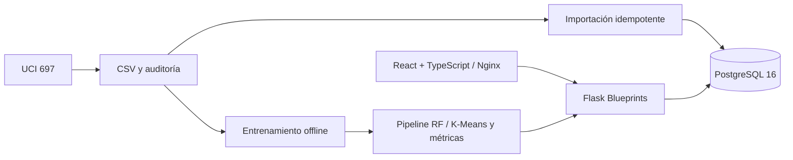

# SmartCampus — MVP Flask + Machine Learning

Monolito modular para explorar abandono y perfiles académicos con UCI 697. La solicitud adjunta más reciente sustituye el stack y alcance de `SPEC.md` y `AGENTS.md`: Flask + PostgreSQL, Random Forest y K-Means; sin Java, FastAPI ni estudiantes ficticios. La Entrega D añade el frontend React sobre esta API, sin reconstruir el backend. Los documentos anteriores se conservan como antecedentes.

Todos los resultados son **EXPERIMENTAL**, nunca `VALIDATED`. Apoyan revisión humana, no sanciones. No existe validación para universidades de Piura.



## Arranque reproducible con Docker

Requisitos: Docker Engine, Docker Compose v2, acceso a Internet para imágenes, dependencias y UCI. Puertos locales 5173, 5000 y 55432 libres. Ejecute desde la raíz del repositorio.

```bash
cp .env.example .env
# Edite .env: reemplace ambas apariciones de replace-with-local-password.
# Use una contraseña local aleatoria alfanumérica (evita escapes en URL).
docker compose up --build -d
docker compose exec api flask --app run init-db
docker compose exec api python -m ml.download_dataset
docker compose exec api flask --app run import-dataset
docker compose exec api python -m ml.train_classifier
docker compose exec api python -m ml.train_clustering
docker compose restart api
curl -fsS http://localhost:5000/api/v1/health
```

Los comandos de inicialización y entrenamiento son explícitos: la API no descarga datos ni reentrena al recibir peticiones. `up` inicia ambos servicios; el resto prepara el dataset y los artefactos. Repetir la importación del mismo CSV inserta cero filas. Una fuente modificada exige otra base, evitando duplicar la cohorte silenciosamente. Las claves internas combinan SHA-256 del CSV y posición original; los IDs de la API no son identificadores institucionales.

Datos y modelos quedan en `data/` y `ml/artifacts/`, montados en los contenedores y excluidos de Git; la base usa un volumen persistente. Tras reentrenar reinicie la API: cada proceso cachea los artefactos. Cargue únicamente artefactos joblib creados por estos scripts y con las mismas dependencias. `docker compose down` detiene la demo y conserva la base.


## Interfaz web — Entregas D y E

Abra **http://localhost:5173/dashboard** después de `docker compose up --build -d` y de preparar los datos/modelos. Incluye dashboard, estudiantes paginados, detalle con 36 variables, predicciones, perfiles K-Means y métricas. La interfaz consume la API existente y muestra resultados experimentales sin inferir datos adicionales. La Entrega E mejora `/students/:id` con notas semestrales sobre 20, evolución, actividad curricular, atributos desplegables y semáforo predictivo con persistencia.

Para desarrollar sin el contenedor web:

```bash
docker compose stop web
docker compose up -d db api
cd frontend
npm install
npm run dev
```

Requiere Node.js 24. La variable `VITE_API_BASE_URL` usa `/api/v1` por defecto; Vite y Nginx resuelven el proxy hacia Flask. La web se publica únicamente en loopback. Consulte [frontend/README.md](frontend/README.md) para arquitectura, pruebas y límites.

## Desarrollo local del backend

Python 3.11+ y PostgreSQL 16. Cree `.env` como arriba, con `DATABASE_URL` apuntando a su PostgreSQL local (puerto publicado 55432, configurable con POSTGRES_PORT).

```bash
python3 -m venv .venv
source .venv/bin/activate
pip install -r requirements.txt
docker compose up -d db
flask --app run init-db
python -m ml.download_dataset
flask --app run import-dataset
python -m ml.train_classifier
python -m ml.train_clustering
python run.py
```

## API

Base: `http://localhost:5000/api/v1`. JSON; sin autenticación para esta demo local. CORS limitado a `CORS_ORIGINS`; no es un mecanismo de autenticación. Listados devuelven solo IDs; el detalle contiene los atributos públicos del dataset, sin nombres, teléfonos ni información institucional inventada.

| Método | Ruta | Resultado |
|---|---|---|
| GET | `/health` | Estado y conexión SQL |
| GET | `/students?page=1&per_page=20` | IDs paginados y filtros de disponibilidad; máximo 100 |
| GET | `/students/{id}` | 36 variables y etiqueta observada, separada de predicciones |
| POST | `/predictions` | Probabilidad experimental, semáforo y persistencia |
| GET | `/predictions/{student_id}` | Última predicción; leer no calcula otra |
| POST | `/clusters/predict` | Asignación persistida, sin semáforo |
| GET | `/clusters` | Estadísticas de los perfiles del entrenamiento |
| GET | `/analytics/summary` | Conteos y distribución de etiquetas observadas |
| GET | `/models/metrics` | Métricas, versiones, columnas y esquema de entrada |

Ambos POST aceptan **exclusivamente** `{"student_id": 1}` o `{"features": {...}}` con las 36 columnas originales. Nunca incluya `Target` dentro de `features`. Use el detalle como plantilla exacta (incluye nombres originales como `Nacionality`). Se rechazan columnas faltantes/extra, nulos, booleanos, números no finitos, fracciones en campos enteros y valores fuera del rango de esta demo. No se imputan datos académicos. Para datos fuera de distribución se requiere revisar el esquema y revalidar el modelo.

```bash
curl -fsS 'http://localhost:5000/api/v1/students?per_page=2'
curl -fsS 'http://localhost:5000/api/v1/students?academic_data=complete&semester_availability=both&evaluation_status=with&evaluation_semester=first'
curl -fsS http://localhost:5000/api/v1/students/1
curl -fsS -X POST http://localhost:5000/api/v1/predictions \
  -H 'Content-Type: application/json' -d '{"student_id":1}'
curl -fsS http://localhost:5000/api/v1/predictions/1
curl -fsS -X POST http://localhost:5000/api/v1/clusters/predict \
  -H 'Content-Type: application/json' -d '{"student_id":1}'
curl -fsS http://localhost:5000/api/v1/clusters
curl -fsS http://localhost:5000/api/v1/analytics/summary
curl -fsS http://localhost:5000/api/v1/models/metrics
```

### Filtros de disponibilidad académica

`GET /students` conserva su contrato de listado y admite estos parámetros opcionales. Los filtros se aplican en PostgreSQL antes de paginar; `academic_summary` siempre resume la cohorte completa, no solo el resultado filtrado.

| Parámetro | Valores |
|---|---|
| `academic_data` | `all`, `complete`, `partial`, `none` |
| `semester_availability` | `all`, `first_only`, `second_only`, `both`, `none` |
| `evaluation_status`, `approval_status` | `all`, `with`, `without`, `zero`, `unknown` |
| `evaluation_semester`, `approval_semester` | `any`, `first`, `second` |

La disponibilidad usa las ocho variables curriculares reales: matriculadas, aprobadas, evaluaciones y nota de cada semestre. Un número, incluido `0`, está disponible; `NULL`, clave ausente, valor vacío, texto o booleano no lo están. `complete` requiere los ocho números, `partial` entre uno y siete y `none` ninguno. Un semestre está disponible si al menos uno de sus cuatro campos es numérico. Los estados «con» evalúan al menos un conteo positivo en el semestre elegido; «sin» significa que no hay positivos, `zero` exige ceros conocidos en todos los campos seleccionados y `unknown` señala algún campo no disponible. Estos criterios describen registros, no la etapa académica.

POST exitoso: 201; entrada inválida: 400; tipo de contenido incorrecto: 415; inexistente/sin predicción: 404; base o modelo no disponible: 503. Errores JSON con `error.code` y `error.message`. Sin modelo no se fabrican probabilidades. Fechas ISO 8601 UTC. Modelo/versión y métricas se registran en `model_runs` en la primera inferencia de esa versión; predicciones y clusters guardan esa referencia, resultado y fecha. El historial se conserva; el endpoint de predicciones devuelve el último registro.

Semáforo provisional: `LOW` si p < 0.30; `MEDIUM` si 0.30 ≤ p < 0.70; `HIGH` si p ≥ 0.70. Configure `RISK_LOW_THRESHOLD` y `RISK_HIGH_THRESHOLD`. Estos umbrales no son criterios científicos ni institucionales validados; las métricas del clasificador usan su decisión binaria estándar, no el semáforo.

## Dataset y evaluación

Fuente única: [Predict Students' Dropout and Academic Success, UCI 697](https://archive.ics.uci.edu/dataset/697/predict), Realinho, Vieira Martins, Machado y Baptista (2021), [DOI 10.24432/C5MC89](https://doi.org/10.24432/C5MC89), licencia CC BY 4.0. Procede de educación superior portuguesa. El objetivo observado corresponde al resultado al final de la duración normal del curso.

`python -m ml.download_dataset` usa `fetch_ucirepo(id=697)` y guarda columnas, tipos, faltantes, duplicados y distribución en `data/raw/audit.json`, además del diccionario original en `variables.json`. La descarga verificada contiene 4,424 filas, 36 entradas, cero duplicados y cero faltantes; 1,421 Dropout, 794 Enrolled y 2,209 Graduate. No contiene asistencia diaria, eventos LMS, teléfonos ni identidad institucional.

**Random Forest:** Dropout=1, Graduate=0, excluye 794 Enrolled. Split estratificado 80/20, semilla 42, transformaciones ajustadas solo en entrenamiento dentro de Pipeline; códigos nominales con OneHotEncoder, otras variables con StandardScaler. Se eliminan vectores de entrada duplicados antes de separar conjuntos. 200 árboles, balanceo de clases; no se ajustan hiperparámetros con el test. `ml/preprocess.py` documenta los 17 campos categóricos. Se utilizan las 36 variables, incluyendo segundo semestre: **solo puede aplicarse cuando esa información ya existe**, no al inicio de la carrera. La probabilidad no está calibrada y se refiere a la comparación binaria, no a los tres estados originales. La inferencia sobre alumnos del propio dataset es una demostración; muchos pertenecen al entrenamiento y no constituye evaluación independiente.

**K-Means:** 12 variables curriculares de ambos semestres, `Course` (one-hot) y `Admission grade`; escalado de variables numéricas. Sin Target ni selección basada en etiquetas. Evalúa K=2…6 con silueta sobre muestra reproducible de hasta 1,500 registros, `n_init=10`; conserva el mayor valor. Las medias y frecuencias por curso describen los grupos. Es una evaluación interna exploratoria, sin validación externa ni garantía de estabilidad; los números de cluster son arbitrarios y pueden cambiar entre versiones.

Los resultados reales completos están en `ml/artifacts/random_forest.json` y `kmeans.json`; cada entrenamiento genera un joblib versionado, hash del CSV, semilla, versión de scikit-learn y fecha. No hay métricas simuladas. La evaluación aleatoria no demuestra transferencia geográfica, causalidad ni reducción del abandono. Faltan validación temporal/institucional, calibración, revisión de sesgos socioeconómicos y requisitos para un piloto real.

## Pruebas

```bash
# Unitarias y flujo completo con SQLite aislado; exige dataset/modelos para no omitir integración.
pytest -q
# Integración real con PostgreSQL: crea y elimina un esquema de prueba independiente.
docker compose exec api sh -c 'TEST_DATABASE_URL="$DATABASE_URL" pytest -q'
# Compilación Python
docker compose exec api python -m compileall -q app ml run.py tests
```

Sin dataset o artefactos, la prueba completa queda explícitamente omitida. Incluye idempotencia, persistencia, endpoints, métricas reales, igualdad de inferencia por ID/variables, entradas inválidas, límites del semáforo y ausencia de modelo. No exponga esta demo públicamente: faltan autenticación, roles, migraciones para cambios de esquema y endurecimiento de producción. El seguimiento de tutores, integración LMS y push quedan fuera de esta entrega. La interfaz web React se incorpora en la Entrega D. Consulte `PROGRESS.md` para evidencia de ejecución.

### Evidencia de esta entrega

Se conservan copias de métricas y auditoría en `reports/` para revisión, sin registros individuales. Los endpoints consultan los artefactos activos, que pueden cambiar después de entrenar nuevamente. En la ejecución verificada: accuracy 0.92149, precision 0.92830, recall 0.86620, F1 0.89617 y ROC-AUC 0.97108; matriz `[[423,19],[38,246]]` sobre 726 registros de prueba. K=2, silueta 0.54866, tamaños 4,144 y 280. El grupo menor presenta más unidades acreditadas y matriculadas en promedio; no implica mayor ni menor riesgo de abandono.

Smoke HTTP, con la API ya preparada:

```bash
python scripts/smoke.py
```

En el entorno de esta entrega faltaba el plugin Compose. Para la verificación se descargó Compose v2.39.4 únicamente en `/tmp/smartcampus-docker/cli-plugins/docker-compose`; puede ejecutar `docker --config /tmp/smartcampus-docker compose ...` mientras ese directorio exista. En una máquina con Compose instalado, use los comandos habituales anteriores.
